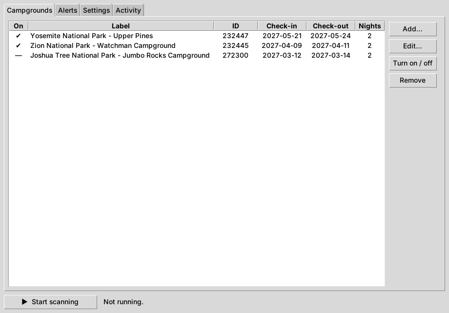

# Campsite Scanner

Watches [Recreation.gov](https://www.recreation.gov) campgrounds (national parks, national
forests, BLM, Army Corps) for cancellations on the dates you want. When a site opens up,
it alerts you by **email**, **phone push (ntfy)**, and/or **SMS (Twilio)**.

It **only alerts you**: you still book the site yourself. Automated booking breaks
Recreation.gov's terms of use, so this tool deliberately doesn't do it.

## Download the Windows app (no Python needed)

1. Go to the [**Releases** page](https://github.com/Ruoxi-Zhu/Campsite-scanner/releases/latest) and download
   `CampsiteScanner.exe`.
2. Double-click it. Windows may show **"Windows protected your PC"** because the app isn't code-signed.
   Click **More info → Run anyway**.
3. In the app:
   - **Campgrounds:** click **Add…**, search for a campground, pick it, and enter your dates.
   - **Alerts:** turn on phone push (ntfy) and/or email, then click **Send a test alert**.
   - Click **▶ Start scanning** and leave the window open (minimizing is fine).

While scanning, the app keeps your PC from going to sleep (the screen can still turn off). When a site
opens up, it sends your alerts and opens the booking page in your browser.

Settings, history and the log are stored in `%APPDATA%\CampsiteScanner`, never next to the program.



## Features

- Watch any number of campgrounds, each with its own date window.
- **Flexible dates:** for example, "any 2 consecutive nights between Jun 4 and Jun 21".
- Optional filters by site type (e.g. tent-only), site number, or loop.
- One alert per new opening. You're alerted again only if an opening disappears and comes back.
- Checks all campgrounds in parallel, every 45 s by default.
- Backs off automatically if Recreation.gov starts rate-limiting, and warns you when it does.
- The log records which site opened and how long it stayed open
  (`GONE … site 042 11/26-11/28 — was open for ~142 s`).

## Command-line version (for developers)

Requires Python 3.8+.

```bash
git clone https://github.com/Ruoxi-Zhu/Campsite-scanner.git
cd Campsite-scanner
python -m pip install -r requirements.txt

# create your private config from the template
cp config.example.toml config.toml        # Windows: copy config.example.toml config.toml
```

Find campground IDs:

```bash
python campsite_scanner.py find "upper pines"
python campsite_scanner.py find "joshua tree"
```

Add them to `config.toml` as `[[watch]]` blocks (the template explains every field),
enable at least one alert type, then:

```bash
python campsite_scanner.py test-notify        # check that alerts reach you
python campsite_scanner.py --dry-run --once   # see what it finds, sends nothing
python campsite_scanner.py                    # run until Ctrl+C
```

On Windows you can also double-click `run_scanner.bat`.

## Alert setup

**Phone push with ntfy (free, recommended).**
1. Install the **ntfy** app (iOS / Android) and subscribe to a topic name that's hard to guess.
2. Put the same topic name in `[notify.ntfy]` and set `enabled = true`.
3. Tapping an alert opens the booking page. Anyone who knows your topic name can read your
   alerts, so treat it like a password.

**Email via Gmail.**
1. Turn on 2-Step Verification on the sending Google account.
2. Create an App Password at <https://myaccount.google.com/apppasswords>.
3. Put the App Password in `[notify.email] password`, or in the `CAMPSITE_SMTP_PASSWORD`
   environment variable.

**SMS via Twilio (paid).** The free carrier email-to-text gateways (vtext.com, tmomail.net,
txt.att.net) are shut down or being phased out, so real SMS needs a provider. For US delivery,
Twilio requires the sending number to be registered (toll-free verification or A2P 10DLC).

### Keeping secrets out of git

- `config.toml`, `state.json` and `scanner.log` are listed in `.gitignore`.
- You can also keep secrets out of the config file entirely by setting environment variables:
  `CAMPSITE_SMTP_PASSWORD`, `TWILIO_ACCOUNT_SID`, `TWILIO_AUTH_TOKEN`, `NTFY_TOKEN`.

## Running it unattended

The scanner only checks while it's running and the computer is awake. Options:

- **Your own PC:** set Windows to never sleep while plugged in, and/or add a Task Scheduler
  task (trigger "At log on", action `pythonw.exe campsite_scanner.py`, start in the repo folder).
  In the classic Command Prompt window, clicking inside the text pauses the program
  (QuickEdit mode). Press Esc to resume, or turn QuickEdit off.
- **An always-on machine:** a small cloud VM (e.g. a Google Cloud e2-micro) or a Raspberry Pi.
  The script runs unchanged on Linux.

## Building the app yourself

GitHub Actions builds `CampsiteScanner.exe` on every push (download it from the run's **Artifacts**), and
pushing a version tag publishes a Release:

```bash
git tag v1.0.0
git push origin v1.0.0
```

To build locally on Windows:

```bash
pip install -r requirements.txt pyinstaller
pyinstaller --onefile --windowed --name CampsiteScanner campsite_gui.py   # → dist/CampsiteScanner.exe
```

To run the tests: `python -m unittest discover -s tests -v`

## Be polite

Keep `check_interval_seconds` at 30 or more. Recreation.gov rate-limits aggressive polling. The
scanner backs off on HTTP 429/403 errors, but hammering the API hurts everyone, you included.

## License

MIT. See [LICENSE](LICENSE).
